  <picture>
    <source media="(prefers-color-scheme: dark)" srcset="assets/terminal-dark.svg">
    
  </picture>

  <a href="https://www.linkedin.com/in/thallys-soares-data-engineer/">LinkedIn</a> ·
  <a href="https://medium.com/@antoniothallys2017">Medium</a>

### About

I'm a Data Engineer at **Accenture**, working day to day on **AI Engineering** — designing GenAI solutions, agentic workflows, and data-driven applications.

I'm especially interested in the engineering behind reliable AI systems: **context retrieval, multi-agent orchestration, evaluation, and architecture**. I like building practical tools that solve real problems.

### Technical focus

`Python` · `LangChain / LangGraph` · `AI Agents` · `RAG` · `MCP` · `SQL` · `Snowflake` · `GCP`

### Selected work

**[Crypto Data Pipeline](https://github.com/thallyssoares/financial-pipeline)** — An ELT pipeline built with Python, Dagster, and BigQuery, using medallion architecture, data quality checks, and CI/CD.

**[E-Commerce Data Streaming](https://github.com/thallyssoares/ecomm-datastreaming)** — An event-processing pipeline combining Redpanda, Bytewax, BigQuery, dbt, and Dagster.

### Writing

I write about real engineering problems, architecture decisions, and lessons learned while building AI systems.

[**Beyond Keyword Matching: Designing Context Retrieval for an Analytics Chatbot**](https://medium.com/@antoniothallys2017/beyond-keyword-matching-designing-context-retrieval-for-an-analytics-chatbot-582db87cf672)

[More on Medium](https://medium.com/@antoniothallys2017)
